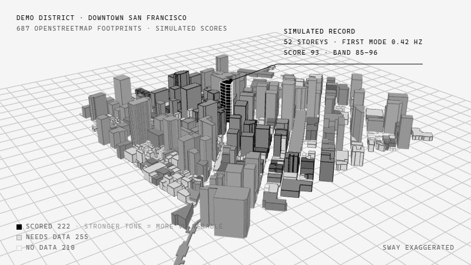

<picture>
  <source media="(max-width: 600px) and (prefers-color-scheme: dark)" srcset=".github/assets/hero-mobile-dark.svg">
  <source media="(max-width: 600px)" srcset=".github/assets/hero-mobile-light.svg">
  <source media="(prefers-color-scheme: dark)" srcset=".github/assets/hero-dark.svg">
  
</picture>

<picture>
  <source media="(prefers-color-scheme: dark)" srcset=".github/assets/rule-01-dark.svg">
  
</picture>

QuakeScore estimates how a building vibrates from phones lying still inside it overnight. It turns that
measurement into a score from 0 to 100 for how vulnerable the building is to an earthquake, with an
uncertainty band. It is a statistical screening layer, not a structural engineering assessment.

It is a research prototype. Every result so far comes from a simulator. No real building has been
measured.

<picture>
  <source media="(prefers-color-scheme: dark)" srcset=".github/assets/rule-02-dark.svg">
  
</picture>

**The problem.** A building's natural frequency says how stiff it is, and stiffness drives how it
responds to shaking. Published work shows a phone accelerometer can pick that frequency up. But a
mid-rise roof moving at night peaks at about 56 µg/√Hz, and a phone's own sensor noise is 70 to
300 µg/√Hz. In one recording the building is at or below the noise.

**What was missing.** A pipeline that works at fleet scale: stack many weak nights per building until
the peak clears the noise, reject peaks that are not structural, attach an uncertainty to every
number, and map the result to a fragility model. That pipeline is what this repository builds.

**Who it is for.** The technical note in `docs/pitch/` is written for reinsurers and catastrophe
modellers, who today work from building class and height rather than a measurement per building.

Derivation and sources: [`DESIGN.md`](DESIGN.md) sections 1 and 2, [`docs/references.md`](docs/references.md).

<picture>
  <source media="(prefers-color-scheme: dark)" srcset=".github/assets/rule-03-dark.svg">
  
</picture>

<picture>
  <source media="(prefers-color-scheme: dark)" srcset=".github/assets/flow-dark.svg">
  
</picture>

1. **Phone at rest.** A session starts only when the phone is flat, still and, by default, charging.
   Seconds with movement are dropped.
2. **On-device processing.** A low-pass filter removes everything above 25 Hz, so no speech survives.
   Three zoom bands cover 0.1 to 20 Hz. Only averaged spectra are kept. Raw samples stay in memory
   and are never written or sent.
3. **Session file.** One small file per night: spectra, building id, floor, sync quality. The upload
   codec rejects location-like fields.
4. **Stack.** The server adds up sessions per building across nights and phones. Sensor noise
   averages down. The structural peak stays.
5. **Identify and reject.** Five estimators recover frequency, damping and mode shape, with bootstrap
   intervals. Tests on peak width, vertical motion and tone shape remove HVAC, elevators, appliances
   and furniture resonances.
6. **Score.** The measured period updates a prior over Hazus 6.1 building classes. A capacity spectrum
   calculation gives damage probabilities for three shaking scenarios. The score is
   `100 × (1 − weighted mean damage ratio)`. It is never shown without its 5–95% band and a
   provenance label.
7. **Track.** Frequency is followed over time and corrected for temperature and season. A lasting
   step is flagged as possible stiffness loss.

<picture>
  <source media="(prefers-color-scheme: dark)" srcset=".github/assets/city-dark.gif">
  
</picture>

<sub>The demo district, drawn from the data file the dashboard reads (`dashboard/data/buildings.geojson`).
Footprints are real: © OpenStreetMap contributors, ODbL. Structures, phones, sessions and scores are
simulated. The sway is exaggerated.</sub>

<picture>
  <source media="(prefers-color-scheme: dark)" srcset=".github/assets/rule-04-dark.svg">
  
</picture>

What the code does today. All of it runs on simulated input.

- **Simulator.** Shear buildings of 1 to 40 storeys with wind and ground forcing, phone noise,
  quantisation, rate error, jitter, tilt and furniture coupling. `quakescore/sim`
- **Device pipeline.** A Python reference with Kotlin and JavaScript ports, checked against shared
  test vectors. `quakescore/device`, `android/dsp-core`, `web/collector`
- **Identification.** Spectral curve fit, FDD, EFDD, SSI-COV and random decrement, with bootstrap
  intervals. `quakescore/ident`
- **Artefact rejection.** Removes non-structural peaks before anything is published. `quakescore/artefacts`
- **Vulnerability model.** Class prior, stiffness anomaly, fragility adjustment, score with band. `quakescore/vuln`
- **Change detection.** Step detection in a frequency series with temperature and seasonal terms. `quakescore/change`
- **Service.** FastAPI with 13 routes: session upload and deletion, building records, coverage,
  portfolio matching, CSV and GeoJSON export. A building is released only with at least 3
  contributors and 5 sessions. `quakescore/service`
- **Dashboard.** Static MapLibre map of the demo district. `dashboard`
- **Collectors.** A [browser page](https://hesselb20-ctrl.github.io/quakescore-collector/) that records
  a night and saves one file, an Android app, and an iOS skeleton. `web/collector`, `android`, `ios`

Simulated results, from [`docs/REPORT.md`](docs/REPORT.md):

| Measure | Result | Label |
|---|---|---|
| First-mode frequency error, peak below the noise floor | 0.11% median (curve fit) | `SIM` |
| Non-structural peaks among published modes | 3.5% (2 of 57) | `SIM` |
| Score band width, without and with a measured period | 15.7 → 8.9 points | `SIM` |
| Demo district buildings scored | 222 of 687 | `SIM` |
| Real sessions, real buildings | 0, 0 | `REAL` |

Known weak points, from the same report:

- Low- and mid-rise buildings on ordinary nights are below the detection limit for most phones under
  the assumed excitation.
- The stiffness-anomaly flag is close to useless with height as the only covariate. A building 30%
  softer than expected is flagged 4% of the time.
- The score has not been validated against earthquake damage.

<picture>
  <source media="(prefers-color-scheme: dark)" srcset=".github/assets/rule-05-dark.svg">
  
</picture>

Requires Python 3.11 or newer. Node is needed only for the collector check. Commands below were run
on Windows 11 with Python 3.15 and Node 26. On macOS or Linux use `.venv/bin/python` instead of
`.venv/Scripts/python`; that path was not tested.

```bash
git clone https://github.com/hesselb20-ctrl/quakescore.git
cd quakescore
python -m venv .venv
.venv/Scripts/python -m pip install -e ".[service,dev]"
```

Run the tests. Expect `51 passed`.

```bash
.venv/Scripts/python -m pytest -q
```

Check the browser collector's signal processing against the Python reference. Expect `ALL PASS`.

```bash
node web/collector/test_dsp.mjs
```

Open the demo dashboard at `http://127.0.0.1:8080/`. It reads committed, simulated data and loads map
tiles from OpenStreetMap.

```bash
.venv/Scripts/python -m http.server 8080 --directory dashboard
```

Start the API at `http://127.0.0.1:8000/v1/meta`. Building routes need the header
`X-API-Key: demo-key`. That key is a placeholder for local use, not authentication.

```bash
.venv/Scripts/python -m uvicorn quakescore.service.app:app --no-access-log --port 8000
```

Loading data into the API, the experiment scripts and the Android build are described in
[`docs/api.md`](docs/api.md), [`experiments/`](experiments) and [`android/README.md`](android/README.md).

<picture>
  <source media="(prefers-color-scheme: dark)" srcset=".github/assets/rule-06-dark.svg">
  
</picture>

**Stack**

| Layer | Built with |
|---|---|
| Simulator, identification, models | Python 3.11+, NumPy, SciPy |
| Service | FastAPI, uvicorn, SQLite |
| Dashboard | MapLibre GL, OpenStreetMap tiles, no build step |
| Browser collector | Plain JavaScript modules, no dependencies |
| Android collector | Kotlin, Gradle |
| iOS | Swift, skeleton only |

**Status**

| Part | State |
|---|---|
| Simulator, identification, artefact rejection, vulnerability, change detection | Built. Measured in simulation only. |
| API and dashboard | Run locally. Nothing is deployed. Storage is SQLite; a PostGIS schema is written but never executed. |
| Browser collector | Deployed as a static page. Driven with simulated sensor events. Never run on a phone. |
| Android app | Compiles, according to the repository's own report. Never installed on a device. |
| iOS app | Skeleton. Samples are counted and discarded. |
| Authentication | Placeholder static key. |
| Real-building validation | Not started. It needs phones in buildings. |

**Roadmap.** The three next steps in the report:

1. Record the first real night. Measure each phone's noise floor on a ground-floor slab, then the same
   phones on an upper floor of one tall and one mid-rise building.
2. Validate on five reference buildings with published ambient values, from 3 to 30+ storeys, and
   publish the comparison table.
3. Run a pilot with a portfolio whose structural systems are documented, and test one question: does a
   measured period change the vulnerability estimate enough to matter.

**Documents**

| File | Contents |
|---|---|
| [`DESIGN.md`](DESIGN.md) | Signal chain, identification, vulnerability mapping, privacy, validation plan |
| [`docs/REPORT.md`](docs/REPORT.md) | Results, failures and next steps |
| [`docs/api.md`](docs/api.md) | API, upload schema, release rules, data loading |
| [`docs/privacy.md`](docs/privacy.md), [`docs/responsible_use.md`](docs/responsible_use.md) | Privacy design and use rules |
| [`docs/validation_protocol.md`](docs/validation_protocol.md) | Field protocol for the first real measurements |
| [`docs/pitch/technical_note.md`](docs/pitch/technical_note.md) | Technical note for reinsurers and catastrophe modellers |
| [`docs/media/quakescore_tutorial.mp4`](docs/media/quakescore_tutorial.mp4?raw=true) | 99-second explainer video, no sound, 12 MB download |

<picture>
  <source media="(prefers-color-scheme: dark)" srcset=".github/assets/rule-07-dark.svg">
  
</picture>

No license file yet. All rights reserved until one is added.

Third-party data keeps its own terms. Building footprints are © OpenStreetMap contributors under ODbL
1.0 ([`data/demo_city/ATTRIBUTION.md`](data/demo_city/ATTRIBUTION.md)). Fragility parameters come from
the FEMA Hazus 6.1 technical manual. Open licence questions are tracked in
[`docs/licences.md`](docs/licences.md).
