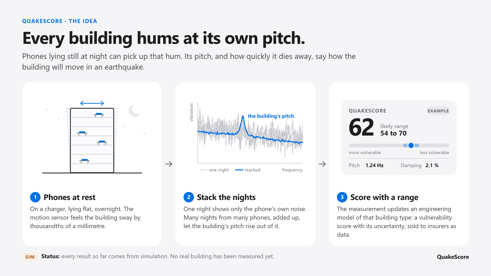
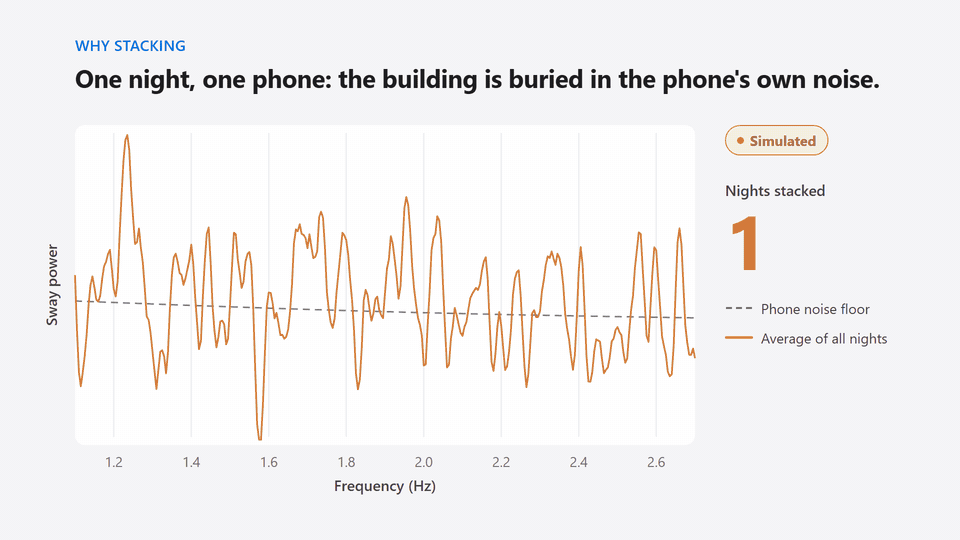
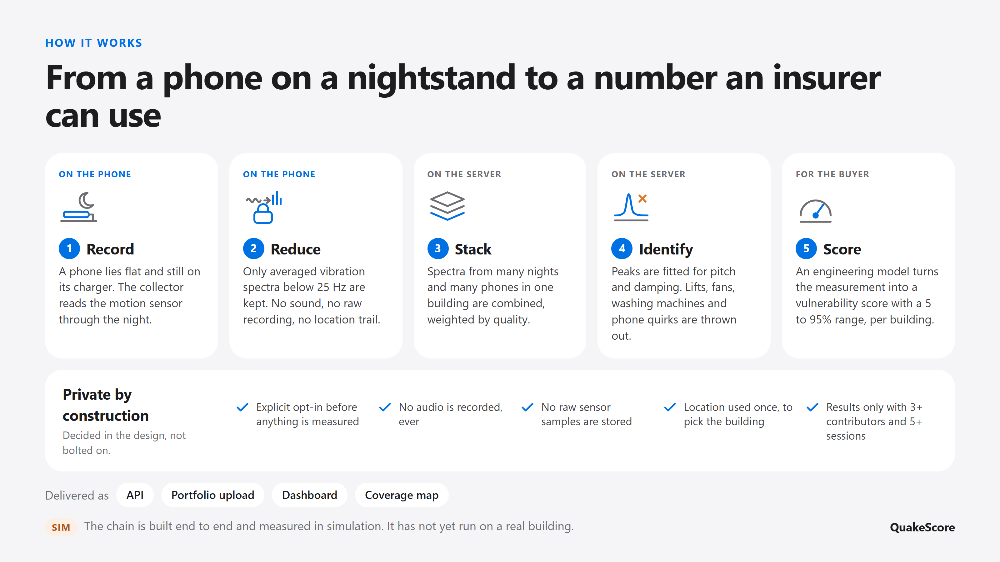
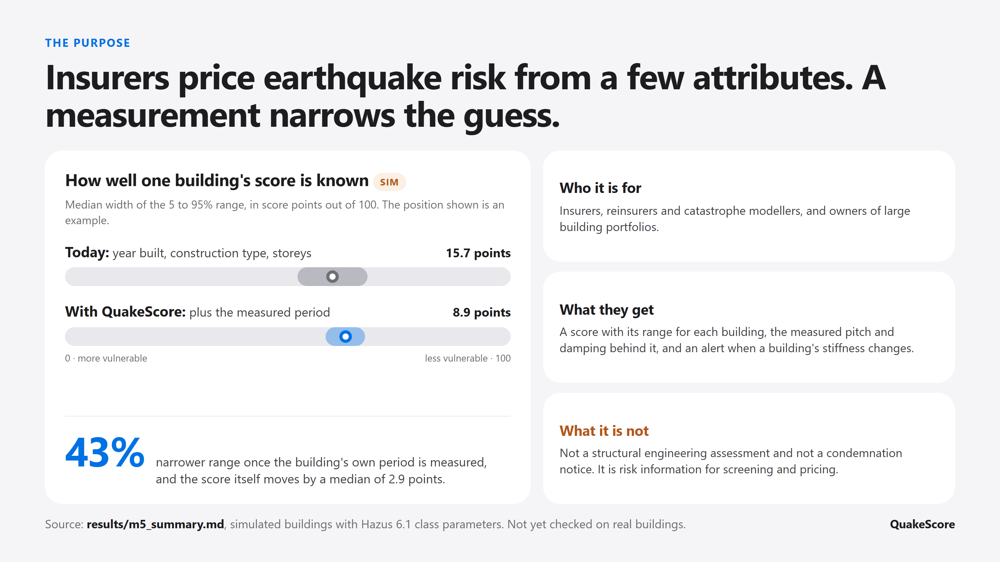
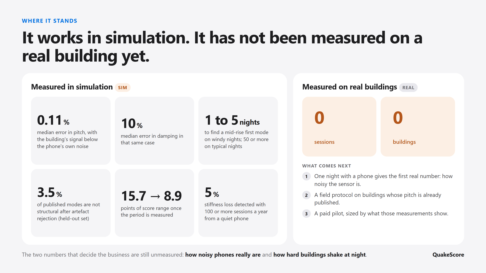
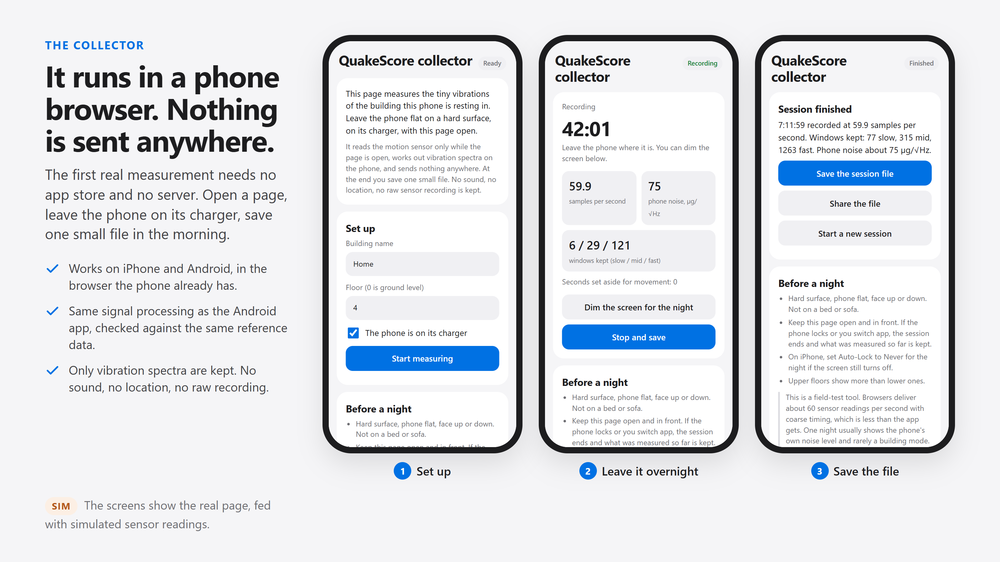

# QuakeScore



QuakeScore estimates a building's natural frequencies and damping from the ambient vibration picked
up by phones lying still inside it, and maps those measurements to a seismic vulnerability score
with an uncertainty band. It is a statistical screening layer, not a structural engineering
assessment.

**Where the project stands.** Everything that can be built and measured on a computer is built and
measured in simulation. Nothing has been measured on a real building yet, because that needs phones
in buildings. Read `docs/REPORT.md` first: it separates what works on real buildings (nothing yet),
what works in simulation, what failed, and the next steps.

Every number in this repository carries one of four labels: `REAL` (measured on a real building),
`SIM` (simulator), `REF` (cited publication), `ASSUMED` (engineering assumption not yet measured).

## The idea in 99 seconds

[](docs/media/quakescore_tutorial.mp4?raw=true)

[Download the tutorial](docs/media/quakescore_tutorial.mp4?raw=true) (MP4, 12 MB, 1 min 39 s, no
sound): the problem, the idea, why stacking works, the pipeline, how to record a night, and what
comes out. GitHub does not play videos stored in a repository, so the link downloads the file. The
clip above is the stacking scene. Everything shown is simulated and says so on screen.

## How it works



## What it is for



## Where it stands



## Record a first night



The shortest route to a real measurement is the browser collector, a single web page that works on
iPhone and Android: https://hesselb20-ctrl.github.io/quakescore-collector/ (source in
`web/collector/`). It sends nothing anywhere and saves one session file.

1. Open the page on a phone, type a building name and floor, lay the phone flat on its charger and
   start. Leave the page open overnight (`web/collector/README.md`).
2. Save the session file in the morning and look at it with
   `python experiments/inspect_sessions.py <folder>`. The phone's measured noise floor is the first
   number to get.
3. On Android, the debug app records unattended with the screen off (`android/README.md`). It
   compiles and its signal processing passes the reference tests, but it has never run on a device.
4. Then run the field protocol in `docs/validation_protocol.md` and compare against published values
   with `experiments/m3_validate_real.py`.

Neither collector has run on a real phone yet; both were checked against simulated sensor data.

## What the buyer sees


The demo dashboard shows simulated structures, phones and scores on real OpenStreetMap footprints.

## Layout

| Path | What it is |
|---|---|
| `DESIGN.md` | Signal chain, identification, vulnerability mapping, privacy, validation plan |
| `docs/REPORT.md` | Final report: results, failures, next steps |
| `docs/pitch/` | Technical note for reinsurers and catastrophe modellers |
| `docs/media/` | Images and the tutorial video used on this page; `docs/media/src` holds their sources |
| `docs/references.md` | Verified citations and published reference values |
| `docs/validation_protocol.md` | Field protocol for the collector test and real-building validation |
| `docs/privacy.md`, `docs/responsible_use.md`, `docs/licences.md` | Privacy design, use rules, licences |
| `docs/platforms.md`, `docs/api.md` | Android, iOS and browser differences, upload schema, API |
| `quakescore/sim` | Building, excitation, phone and interference simulator (time-domain and fast spectral path) |
| `quakescore/device` | Reference on-device feature pipeline |
| `quakescore/ident` | Stacking, detection, curve fit, EFDD, SSI-COV, random decrement, FDD, bootstrap |
| `quakescore/artefacts` | Rejection of non-structural peaks |
| `quakescore/vuln` | Class model, capacity spectrum method, fragility, QuakeScore |
| `quakescore/change` | Frequency tracking and change detection |
| `quakescore/product.py` | Batch job from sessions to building records |
| `quakescore/service` | API, storage, portfolio matching, coverage |
| `dashboard` | Static demo dashboard (MapLibre GL, OpenStreetMap tiles) |
| `web/collector` | Browser collector: one page, same signal processing, saves a session file. Checked with simulated sensor readings; not yet run on a phone |
| `android`, `ios` | Collector app. Android compiles and its DSP passes the reference tests; not yet run on a phone. iOS is a skeleton |
| `tutorial` | Source of the tutorial video (Remotion) |
| `experiments` | One script per milestone; outputs in `results/` |
| `results/*_summary.md` | Measured tables per milestone |

## Run it

```bash
python -m venv .venv
```

```bash
.venv/Scripts/python -m pip install numpy scipy pytest fastapi uvicorn httpx python-multipart matplotlib markdown
```

```bash
.venv/Scripts/python -m pytest -q
```

```bash
node web/collector/test_dsp.mjs
```

Experiments (set `PYTHONPATH=.`; each writes JSON and a Markdown summary under `results/`):

| Command | Milestone | Rough time on 6 cores |
|---|---|---|
| `python experiments/m1_run.py` then `python experiments/m1_report.py` | 1: simulator and identification | 30 min |
| `python experiments/export_device_vectors.py` | 2: test vectors for the Kotlin and JavaScript DSP | 1 min |
| `python experiments/m3_validate_real.py <session folder>` | 3: real-building comparison | seconds |
| `python experiments/inspect_sessions.py <session folder>` | 2-3: first look at real session files | seconds |
| `python experiments/m4_artefacts.py` | 4: artefact rejection | 10 min |
| `python experiments/m5_vulnerability.py` | 5: vulnerability model | 4 min |
| `python experiments/m6_change.py` | 6: change detection | 15 min |
| `python experiments/demo_city.py` then `python experiments/summaries.py` | 7: demo city records | 10 min |
| `python experiments/make_figures.py` | 8: figures for the technical note | 1 min |
| `node docs/media/src/build.mjs` | Images on this page | 1 min |
| `bash tutorial/render.sh` (after `npm install` in `tutorial/`) | Tutorial video, poster and teaser | 3 min |

API and dashboard:

```bash
.venv/Scripts/python -m uvicorn quakescore.service.app:app
```

See `docs/api.md` for loading footprints and results, and for exporting the static dashboard data.

## Data and licences

Footprints in `data/demo_city` are from OpenStreetMap contributors (ODbL). Fragility parameters are
from the FEMA Hazus 6.1 technical manual. See `docs/licences.md` for what has to be settled before
any data is sold.
