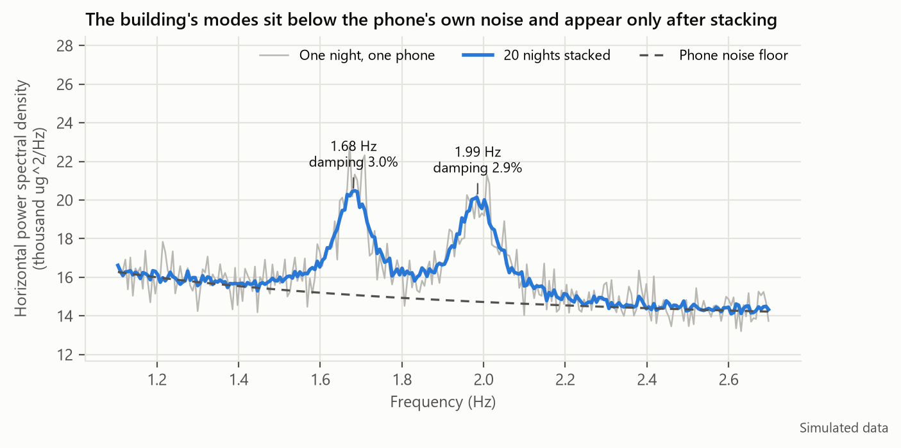
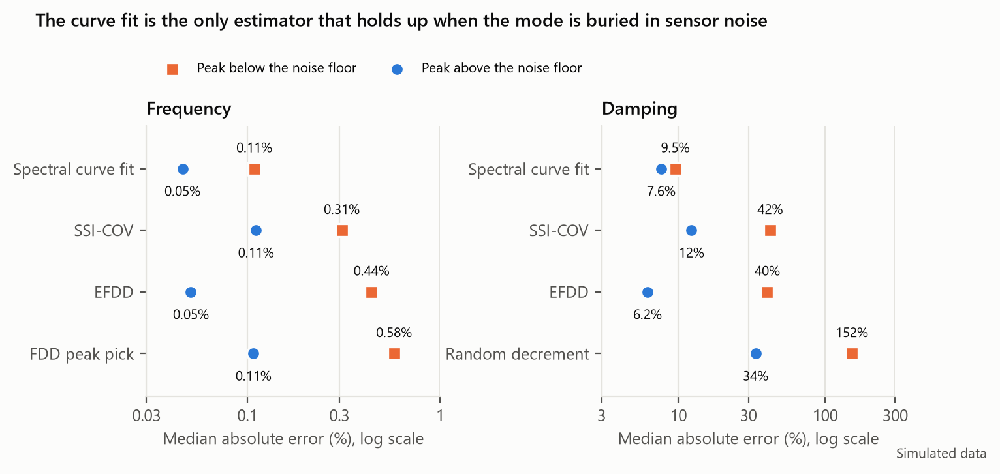
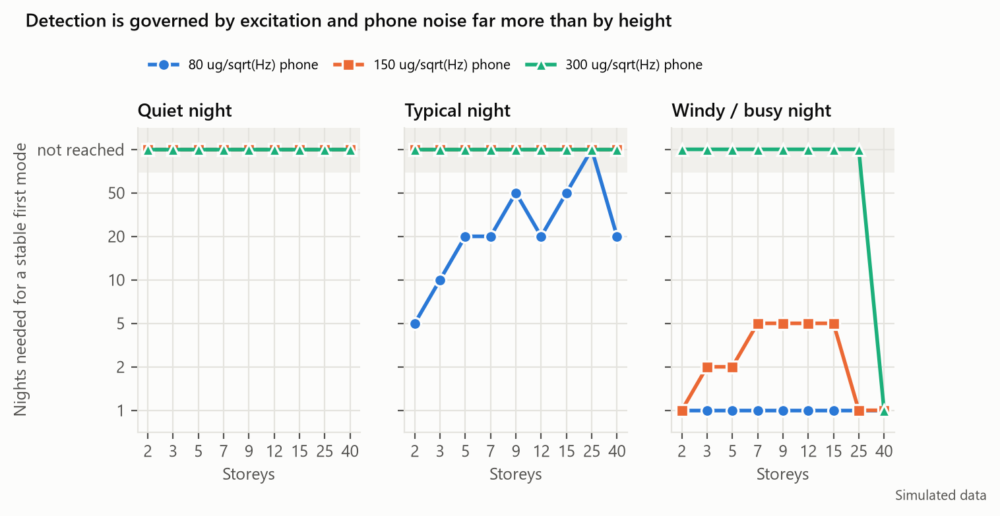
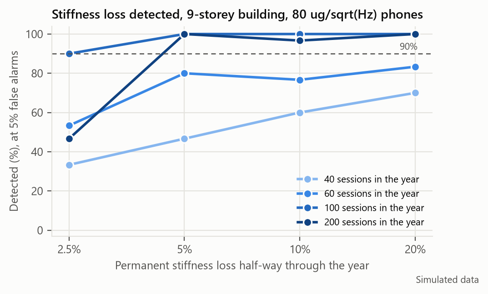
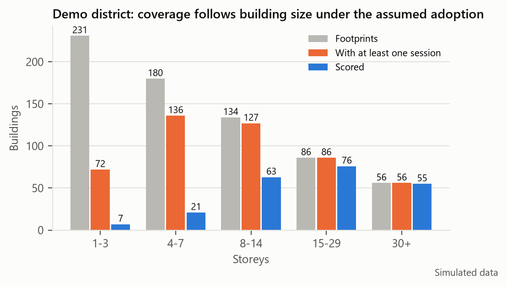
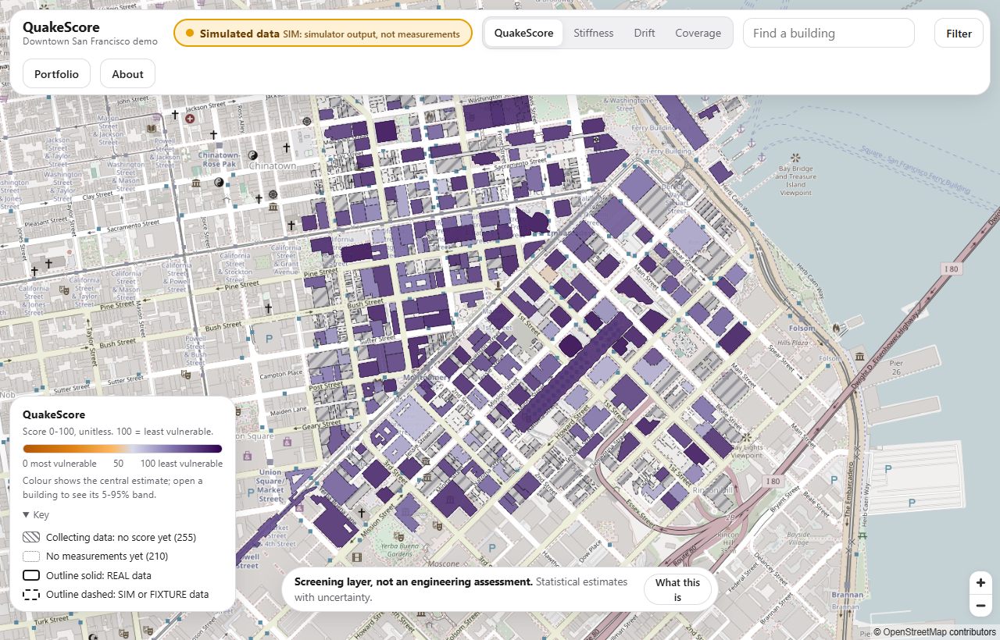

# QuakeScore: measured building dynamics for seismic risk models

Technical note for reinsurers and catastrophe modellers. November 2026.

> **Status, stated first.** The method is built end to end and measured in simulation. It has **not**
> been measured on a real building yet: the collector app compiles and its signal processing passes the
> reference tests, but it has not run on a phone, and no real session exists. Every result in this note is labelled. [SIM] is simulator output, [REF]
> is a cited publication, [ASSUMED] is an engineering assumption not yet measured, [REAL] would be a
> measurement on a real building and appears nowhere below. A pilot partner is asked to help close
> exactly that gap (section 10).

## 1. The problem and the idea

Catastrophe models assign a building's seismic vulnerability from proxies: construction class, age,
height band. Two buildings with the same labels can differ by a factor of two in lateral stiffness,
and the model cannot see it. The physical quantities that govern response are the natural
frequencies, damping and mode shapes, and they are measurable: every building sways by a few
micro-g under wind, traffic and footfall.

QuakeScore reads that sway with the accelerometers already inside the building. A phone lying still
overnight on a desk or nightstand records it. One night from one phone is far too noisy to use. Many
nights from many phones, stacked per building, are not. The output is a per-building record: first
natural frequencies and damping with intervals, a structural-class probability, a stiffness anomaly
against the class, damage-state probabilities for standard shaking scenarios, a 0-100 score with an
uncertainty band, and a frequency history that flags lasting stiffness loss.

What it is: a statistical screening layer that replaces a guess with a measurement where coverage
allows. What it is not: a structural engineering assessment of any individual building.

## 2. What is already known, and what is not

Three published results set the starting point [REF]; full citations are in `docs/references.md`.

| Study | What it showed | What it did not show |
|---|---|---|
| Kong et al. 2018, Seismological Research Letters | 25 phones on one floor of Millikan Library recovered 1.2, 1.7 and about 2.4 Hz during a forced (shaker) test | Ambient recovery, which the authors name as future work |
| Patel et al. 2023, Sensors | Earthquake-triggered phone recordings gave fundamental frequencies for 7 buildings of 3-18 storeys; repeats agreed within 7% | The authors judged ambient measurement infeasible at phone noise levels |
| Kumar et al. 2025, Journal of Building Engineering | Ambient phone data over about 6 months recovered the first modes of 4 tall buildings (54-197 m), for example 0.47 Hz against a 0.48 Hz reference | Short buildings: many recordings rejected for low signal-to-noise |

Two consequences shape this product. First, ambient identification with phones is demonstrated only
for tall buildings; low- and mid-rise coverage is an open question that our own simulation also flags
as the hard case (section 5). Second, none of these papers names insurers or risk transfer as an
application, and no catastrophe model uses such data. The method is known; the fleet pipeline and the
mapping to vulnerability are the new parts.

One number is unresolved and matters: published phone noise spectra for recent models sit roughly
12-20 dB below the noise densities in sensor datasheets (70-180 ug/sqrt(Hz)). We design against the
datasheet values, which is the pessimistic case, and show the optimistic case as a sensitivity.

## 3. Method

**On the phone.** The app records only when the phone is flat, still, screen-off and (by default)
charging. Samples are resampled to a common UTC-anchored grid, low-pass filtered to 20 Hz and
decimated; nothing above 25 Hz survives, which rules out audio by construction. The phone computes
windowed cross-spectral matrices in three zoom bands (0.1-1.25, 1.25-5 and 5-20 Hz, each resolving
0.5% of frequency or better) and uploads only those averages, a building id, a floor estimate and
clock-sync quality: about 150 kB per night. Raw samples never leave the phone and are never stored.
The only position that leaves the phone is a point rounded to about 1 km, used once to fetch nearby
footprints so the building can be picked on the device.

**Per building.** Sessions are stacked with inverse-variance weights using the rotation-invariant
horizontal trace, so a phone's unknown compass orientation does not matter. Sensor noise appears as a
smooth floor; a mode appears as a narrow bump of known shape. A matched filter scans frequency and
damping for bumps, an iterative detect-fit-subtract loop separates neighbouring modes (including the
two horizontal directions when they are close), and each mode is estimated by a likelihood fit of the
single-mode response shape. Intervals come from a bootstrap over sessions, widened for small samples
and for model error.

**Rejecting what is not the building.** A candidate must pass all of: a width test (machinery tones
are narrower than any structure, furniture resonances broader); a tone test and a burst test on the
per-window statistics; a vertical test (a lateral building mode has no vertical motion, floor-borne
machinery does); a support test and a single-session test (the peak must be present in the sessions
themselves, and not in one night only); a fleet test (a frequency that one phone model reports across
many unrelated buildings is the phone, not the building); a detection threshold; and a mode-order
check, which refuses to score when the lowest identified peak may be a second mode.

**Privacy.** Opt-in, plain-language consent. Outputs for a building are released only when at least
3 contributors and 5 sessions are combined, so one household's presence cannot be inferred.

## 4. Identification under sensor noise

In the example above [SIM] the peak is about a third of the height of the noise floor. One night shows
nothing reliable; twenty nights give both first modes within 0.2% in frequency.

We implemented five estimators and let the simulator choose [SIM]. Sessions were generated by a full
time-domain simulation (building response, phone noise, quantisation, non-nominal sample rate,
timestamp jitter, tilt, furniture coupling) and processed by the same pipeline the phone runs.

| Regime | Curve fit | SSI-COV | EFDD | FDD peak pick | Random decrement |
|---|---|---|---|---|---|
| Frequency error, peak below noise floor | 0.11% | 0.31% | 0.44% | 0.58% | n/a |
| Frequency error, peak above noise floor | 0.05% | 0.11% | 0.05% | 0.11% | n/a |
| Damping error, peak below noise floor | 10% | 42% | 40% | n/a | 152% |
| Damping error, peak above noise floor | 8% | 12% | 6% | n/a | 34% |

Median absolute errors, 105 identified modes [SIM]. The production estimator is the curve fit; EFDD and
SSI-COV are kept as cross-checks when the peak clears the noise floor. Frequency is the robust
output. Damping is usable but soft: its 90% interval is typically 39% of the value wide, and it
covers the truth in 87% of cases in simulation (95% for frequency). We report damping with its
interval and do not let it drive the score unless the interval is tight.

Detector false alarms on pure noise, with no structure present: 1.25% of building stacks at a
detection score of 6 and none in 400 stacks at a score of 7 [SIM]. The release threshold is 7, or 6
when two contributors see the peak independently.

## 5. Detection limit by building height

Whether a mode can be found depends on one ratio: the mode's peak spectral density over the phone's
noise density. Record length, number of nights and number of phones then buy detection as the square
root of the amount of data.

Nights needed before the first mode is found within 2% in at least 90% of trials (6-hour nights, one phone per night on the
top floor unless stated, random orientation, 15% of phones on soft surfaces) [SIM]. `>50` means not reached in 50 nights.

| Storeys | Typical night: 80 / 150 / 300 ug phone | Windy or busy night: 80 / 150 / 300 ug phone | Same, phone at mid-height |
|---|---|---|---|
| 3 | 10 / >50 / >50 | 1 / 2 / >50 | 1 / 10 / >50 |
| 5 | 20 / >50 / >50 | 1 / 2 / >50 | 5 / >50 / >50 |
| 9 | 50 / >50 / >50 | 1 / 5 / >50 | 2 / >50 / >50 |
| 15 | 50 / >50 / >50 | 1 / 5 / >50 | 1 / 50 / >50 |
| 25 | >50 / >50 / >50 | 1 / 1 / >50 | 1 / 5 / >50 |
| 40 | 20 / >50 / >50 | 1 / 1 / 1 | 1 / 1 / 2 |

On quiet nights no height and no phone class reached a stable first mode within 50 nights. As a rule across all 171
configurations: when the peak-to-noise power ratio of a single night is above 0.1, a stable first mode arrives within 5
nights in more than 90% of cases; between 0.03 and 0.1 it arrives within 5 nights in 43% and within 50 in 86%; below 0.01
it never arrives. Once detected, the median frequency error is 0.10% and the 90th percentile 0.5%.

Sensitivity [SIM]: with a 25 ug/sqrt(Hz) phone the same buildings of 3, 9 and 25 storeys need 1, 1 and 1 night(s) on a
typical night, and 10, 20 and >50 on a quiet one.

Reading the result [SIM]:

- **Excitation dominates.** The same building moves from "one or two nights" to "not reached in 50
  nights" between a windy or busy night and a quiet one. The excitation levels are assumptions
  [ASSUMED] taken from published ranges; they are the largest unknown and the first thing a pilot
  measures.
- **Phone noise is next.** Each halving of noise density is worth roughly a factor of 16 in nights.
  If recent phones are as quiet as published fleet spectra imply (25 ug/sqrt(Hz) rather than 80-300),
  most of the "not reached" cells close. Measuring real noise floors per phone model is therefore a
  cheap, decisive early experiment.
- **Height helps through wind, not by itself.** Tall buildings respond strongly to wind and are the
  easy case, which matches the published record. Low-rise buildings depend on ground-borne noise and
  are the hard case.
- **Floor matters.** A phone at mid-height sees roughly half the first-mode amplitude of one at the
  roof, so it needs about 16 times as many nights at the detection limit.

Several phones recording the same night help more than the same number of separate nights if their
clocks are synchronised: coherent processing of 4 phones gave about 3 times the detection score of
stacking them incoherently, and 8 phones about 4 times, with no loss from clock errors up to 200 ms at
these frequencies [SIM]. The same data give first-mode shape amplitudes to about 2% RMS when the mode
is well above the limit. This tier needs per-window spectra and is opt-in.

## 6. Non-structural peaks

Buildings are full of things that vibrate: fans, pumps, elevators, washing machines, and the phone
itself. We built a labelled test [SIM]: 48 buildings and 432 four-hour sessions simulated in the time domain, with three phone models (one carrying a self-noise resonance and a 1 Hz tick in every building), persistent HVAC tones and elevator rumble per building, appliances, mains aliases and footsteps per night, a quarter of the phones on soft surfaces, and calm and windy nights mixed. Thresholds were set on one such set and frozen; the numbers below come from a second, held-out set.

| | Candidate peaks | Accepted as structural |
|---|---|---|
| Structural | 80 | 55 |
| Non-structural | 266 | 6 |
| Share non-structural | 76.9% | 9.8% |
| Published modes (lowest three per building) | | 55 structural, 2 non-structural: **3.5%** |

Three quarters of raw candidates are not the building. After rejection, 3.5% of the modes the product would publish are non-structural (2 of 57), and the reported fundamental is a true first mode in 34 of 36 buildings. The price is coverage: 31% of genuine structural candidates are rejected too, and 12 of 48 buildings get no fundamental. Appliances, HVAC tones, phone resonances and tick harmonics are almost all caught by the width test and the vertical test. What still gets through is mostly blends of closely spaced higher modes.

Two honest limits. The thresholds were tuned on simulated interference and must be re-tuned on
labelled real sessions. And a weak machine tone whose speed wanders by a fraction of a percent from
night to night can imitate a lightly damped mode; the tests above catch it only when it is strong
enough to register as a tone within a single night.

## 7. From measured dynamics to vulnerability

**Class.** A prior over Hazus model building types from height, age, tags and a regional mix is
updated with the likelihood of the measured period under each type's period-height relation. The
class is reported as a distribution with a GEM taxonomy label.

**Stiffness anomaly.** The stiffness ratio is (expected period / measured period) squared under the
most probable class. A flag is raised only if the building is softer than every plausible class by
more than two standard deviations, because class and stiffness are otherwise confounded.

**Fragility.** We start from the published Hazus 6.1 capacity curve and structural fragility of the
class [REF]. The measured period rescales the elastic period, which moves the performance point found
by the capacity spectrum method; where a mode shape is available, drift concentration in the lower
storeys rescales the damage-state thresholds. Damage-state probabilities follow for PGA 0.15, 0.30
and 0.60 g on a standard spectral shape.

**Score.** QuakeScore is 100 x (1 - weighted structural mean damage ratio) over those scenarios;
100 is the least vulnerable. The band is the 5-95% interval from propagating the measurement
bootstrap and the class probabilities.

| Score for a class at its typical height, moderate code | Stiffness 50% of expected | 70% | as expected | 150% | Drift concentration 1.5x | 2x |
|---|---|---|---|---|---|---|
| Mid-rise concrete frame (C1M) | 75.7 | 77.7 | 79.3 | 80.6 | 69.7 | 62.0 |
| High-rise steel frame (S1H) | 66.5 | 69.6 | 72.3 | 74.7 | 60.5 | 51.4 |

The score responds only mildly to stiffness on its own (3 to 6 points for a halving) and strongly to
drift concentration. Most of the value of a measured period comes through the class it implies.

What a measurement adds [SIM]: over 200 random buildings the 5-95% score band narrows from a median
of 15.7 points with public attributes only to 8.9 points with a measured period, and the score moves
by a median of 2.9 points and by more than 9.1 points for one building in ten.

What it does not yet add: with height as the only covariate, the anomaly flag is weak. A building 30%
softer than expected for its class is flagged 4% of the time, 50% softer 12%, 75% softer 50%, at a
false-flag rate under 1% [SIM]. Class scatter hides all but gross anomalies. Better covariates (plan
dimensions, wall density, known structural system from an insurer's own schedule) are the lever, and
they are data a pilot partner already holds.

**Validation of the score.** The adjustment is physics on top of a published framework; it has not
been calibrated against observed damage. No open dataset pairs a pre-earthquake modal measurement
with a post-earthquake damage grade for the same buildings, so building-level validation is not
possible today. Class-level checks against reconnaissance data and expert ratings are the realistic
next step. Until then the score's validity is inherited from Hazus, and the measured period should be
read as the reliable deliverable.

## 8. Change detection

A building's frequency is tracked over time and regressed on outdoor temperature (and season and
vibration amplitude when the series is long enough). A lasting step in the residual is tested at
every admissible date. In the synthetic damage test [SIM] a building is observed for a year and loses
stiffness half-way through.

Detection rate at a threshold set for 5% false alarms on loss-free runs [SIM]. Each epoch is five nights; calm and windy
nights alternate at random, so some epochs carry no usable signal.

| Building and phone | Sessions in the year | Epochs usable | 2.5% loss | 5% loss | 10% loss | 20% loss | Smallest loss detected 9 times in 10 |
|---|---|---|---|---|---|---|---|
| 9 storeys, 80 ug phone | 40 | 81% | 33% | 47% | 60% | 70% | not reached |
| 9 storeys, 80 ug phone | 60 | 80% | 53% | 80% | 77% | 83% | not reached |
| 9 storeys, 80 ug phone | 100 | 83% | 90% | 100% | 100% | 100% | 2.5% |
| 9 storeys, 80 ug phone | 200 | 84% | 47% | 100% | 97% | 100% | 5% |
| 9 storeys, 150 ug phone | 40 | 29% | 0% | 13% | 3% | 10% | not reached |
| 9 storeys, 150 ug phone | 60 | 28% | 10% | 13% | 20% | 30% | not reached |
| 9 storeys, 150 ug phone | 100 | 34% | 40% | 63% | 70% | 63% | not reached |
| 9 storeys, 150 ug phone | 200 | 41% | 63% | 67% | 67% | 73% | not reached |
| 25 storeys, 80 ug phone | 40 | 55% | 23% | 7% | 13% | 10% | not reached |
| 25 storeys, 80 ug phone | 60 | 55% | 23% | 43% | 43% | 43% | not reached |
| 25 storeys, 80 ug phone | 100 | 60% | 73% | 90% | 83% | 93% | 5% |
| 25 storeys, 80 ug phone | 200 | 59% | 57% | 93% | 100% | 100% | 5% |

Read across the table: a 5% stiffness loss (2.5% in frequency) is caught reliably with 100 or more sessions a year from
80 ug phones, and is not caught reliably with 60 sessions or with 150 ug phones. Each cell has 30 trials, so individual
rates carry roughly 9 points of sampling error.

After temperature correction the residual scatter of the frequency series is 0.63% to 1.39%, set mostly by the assumed
unobserved environmental term. The estimated step sizes are unbiased (a 10% stiffness loss is recovered as a 5% frequency
drop). Tracking registers every epoch against reference modes identified in a baseline period, which uses all peaks
jointly; an earlier version that re-detected peaks in each epoch failed because it sometimes latched onto the neighbouring mode.

Published monitoring shows that frequencies wander by 0.3-3% with temperature, rain and wind, and
that changes under about 0.5% cannot be tied to damage [REF]. Our simulated environmental terms are
assumptions at the mild end of that range, so the real floor may be higher.

## 9. Coverage: demo district and a sample portfolio

The demo uses 687 real OpenStreetMap building footprints in downtown San Francisco [REAL footprints
only]. Structures, contributors and sessions are simulated: one contributing phone per 1500 m2 of
floor area, twelve nights each on average, a mix of phone noise classes and of calm and windy nights
[ASSUMED].

Of 687 footprints, 222 are scored, 255 have sessions but not enough for a released result, and 210 have none [SIM]. Coverage follows height: 131 of 142 buildings of 15 storeys or more are scored, 63 of 134 with 8 to 14, 21 of 180 with 4 to 7, and 7 of 231 with 1 to 3. Against the simulated truth the first-mode frequency has a median error of 0.04% and is within 5% in 94% of scored buildings; in 13 of 222 the pipeline reported the other horizontal direction or a higher mode as the fundamental. Of 25 buildings planted with 30-55% of expected stiffness, 8 were scored and 2 were flagged (3 flags in total). All 4 scored buildings given a 12% stiffness loss raised a frequency-drop alert, with 1 false alert among the other 218.

**Sample portfolio report** [SIM]. An insurer uploads addresses or coordinates and receives, per row,
the match, the score with its band, the measured parameters and the coverage status.

| Ref | Storeys | Status | Sessions | QuakeScore (5-95%) | Class only | f1 (Hz) | Stiffness vs class | Alerts |
|---|---|---|---|---|---|---|---|---|
| P-1000 | 27 | scored | 120 | **88** (76-93) | 88 | 0.44 | 167% | - |
| P-1002 | 24 | scored | 120 | **90** (69-94) | 83 | 0.90 | 89% | - |
| P-1003 | 10 | scored | 120 | **65** (43-82) | 71 | 1.17 | 86% | - |
| P-1004 | 58 | scored | 120 | **96** (96-97) | 96 | 0.24 | 130% | - |
| P-1009 | 8 | scored | 120 | **79** (39-91) | 66 | 3.19 | 108% | - |
| P-1010 | 52 | scored | 120 | **93** (85-96) | 92 | 0.42 | 87% | - |
| P-1011 | 38 | scored | 120 | **90** (82-94) | 90 | 0.33 | 149% | - |
| P-1013 | 6 | scored | 44 | **85** (59-95) | 85 | 3.59 | 85% | - |
| P-1015 | 22 | scored | 120 | **88** (77-92) | 86 | 0.43 | 135% | - |
| P-1001 | 10 | needs data | 11 | not released | 74 | - | - | - |
| P-1005 | 6 | needs data | 22 | not released | 86 | - | - | - |
| P-1006 | 4 | no data | 0 | not released | 78 | - | - | - |

Portfolio of 40 locations of four storeys or more: 21 scored (52% coverage), median score 89, lowest decile below 70, median band width 17 points, 0 stiffness flags, 0 frequency-drop alerts. Twelve rows shown; addresses withheld because the scores are simulated.

Coverage strategy. The detection limit says where to start: tall and mid-rise buildings in dense,
windy, traffic-heavy districts, with recent phones. The app shows residents their building's status
and how many more nights it needs, and rewards contributions in under-covered buildings. Distribution
through a partner app (an insurer's policyholder app, a property manager's tenant app) reaches many
phones in the same buildings at once, which is what the method needs.

## 10. Uncertainty, limits and what a pilot would settle

Every released number carries its interval and its provenance label; there is no interface that
returns a score without its band.

| Question | Status today | What settles it |
|---|---|---|
| Does it work on real buildings? | Not measured [SIM only] | 5+ buildings of 3 to 30+ storeys with published modal values, protocol in `docs/validation_protocol.md` |
| How noisy are real phones? | Datasheets and published spectra disagree by 12-20 dB | One night on a ground-floor slab per phone model |
| How strong is ambient excitation by building type? | Assumed from published ranges | The same pilot sessions |
| Do the artefact thresholds hold? | Tuned on simulated interference | Labelled real sessions from the pilot buildings |
| Is the score predictive of damage? | Inherited from Hazus; adjustment unvalidated | Class-level comparison with reconnaissance data; expert ratings; long-term, post-event follow-up |
| Battery cost per night | Not measured | Collector field test; target under 3% |

What we ask of a pilot partner: access to a few tens of buildings where the structural system is
known from engineering reports, a channel to occupants willing to opt in, and the partner's own view
of which output is worth paying for: the measured period as a model input, the anomaly flag for
underwriting referral, or the change alert after an event.
