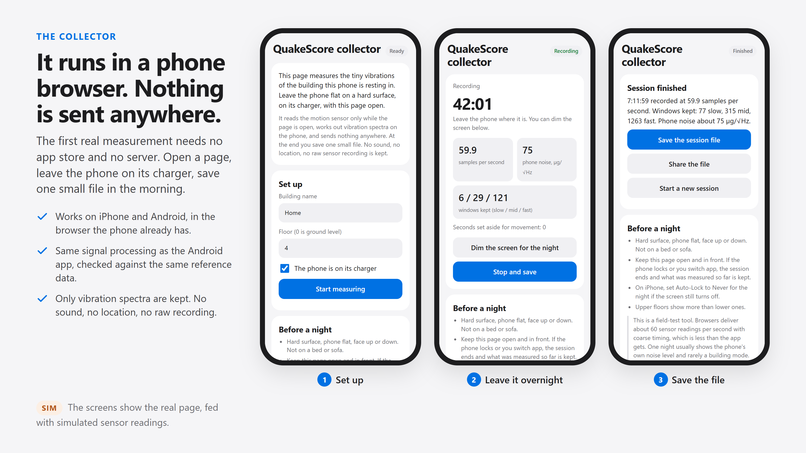

# QuakeScore browser collector

A single web page that records a vibration session with the phone's own browser. It exists so the
first real night can be measured on an iPhone, or on any Android phone, without installing an app.

**Status: checked with simulated sensor readings; never run on a phone.**

- The JavaScript signal processing is a port of the Kotlin one in `android/dsp-core`. It reproduces
  the Python reference on three streaming test vectors, in all three bands, to about 5e-7 relative
  (`node web/collector/test_dsp.mjs`, 23 checks).
- Session files written by the page code are read by the server codec and the inspection script
  (`node web/collector/test_session_file.mjs`, then `python experiments/inspect_sessions.py`).
- The page itself was driven in a desktop browser with simulated `devicemotion` events: 12 minutes
  of white noise at 59.94 Hz gave a noise reading of 74 ug/sqrt(Hz) against 74.5 expected. A denied
  motion permission is reported to the user and nothing starts.
- Not checked: real sensor delivery on iOS and Android, how long a phone keeps the page awake, and
  battery cost. Those are what the first night is for.

## What it does

While the page is open it reads `devicemotion` (acceleration including gravity), resamples it onto
the same 100 Hz grid the app uses for slow sensors, applies the same privacy filter, bands, windows
and movement gate, and keeps only averaged spectra. Nothing is uploaded. At the end the user saves
one JSON file (upload schema v1, about 200 kB) and sends it on by hand.

It asks for no location and records no sound. The building is whatever name the user types; it is
stored as `test:<name>`, the same field-test convention as the Android debug build.

## Use

A hosted copy is at https://hesselb20-ctrl.github.io/quakescore-collector/. It is served from the
public repository `hesselb20-ctrl/quakescore-collector`, which holds only the five page files and a
short README; copy changed files there to update it. The deployed page was driven with the same
simulated session as the local one and gave the same result.

To host it elsewhere: the page needs https, because browsers only give motion data to secure pages.
Any static host works; the files are `index.html`, `app.js`, `session_file.js`, `dsp.js` and
`fir_taps.js`.

1. Open the page on the phone. Type a building name and the floor.
2. Put the phone flat on a hard surface, on its charger, and press "Start measuring". On iPhone,
   allow motion access when asked.
3. Leave the page open and in front. "Dim the screen for the night" shows a black screen with a
   small clock. On iPhone, set Auto-Lock to Never for the night.
4. In the morning press "Stop and save", then "Save the session file" or "Share the file".
5. On the computer, put the files in a folder and run
   `python experiments/inspect_sessions.py <folder>` (with `PYTHONPATH=.`).

If the phone locks, the browser is closed or another app comes to the front, the sensor stream
stops and the session ends there. What was measured up to the last minute is kept, and "Save the
last session again" on the start screen gets it back.

## Limits compared with the app

| Topic | Browser | Android app |
|---|---|---|
| Sensor rate | about 60 readings a second | up to 200 |
| Usable band | the same three bands; the top band is noisier because of the low rate | full |
| Timing | event timestamps on the page clock, no clock synchronisation (`sync_source` "none") | GNSS or network time |
| Unattended | no: the page must stay open with the screen on | yes, screen off |
| Floor | typed by hand | barometer or by hand |
| Battery level in the file | where the browser exposes it, else null | always |

One night from one phone usually shows the phone's own noise floor and rarely a building mode.
That noise floor is still the most useful first number: it is the one the detection-limit tables
depend on most.

## Files

| File | What it is |
|---|---|
| `index.html`, `app.js` | The page and its logic |
| `dsp.js`, `fir_taps.js` | Streaming signal processing; the filter taps are generated by `experiments/export_device_vectors.py` |
| `session_file.js` | Builds the session file from a finished session |
| `test_dsp.mjs`, `test_session_file.mjs` | Node tests against `tests/vectors` |
